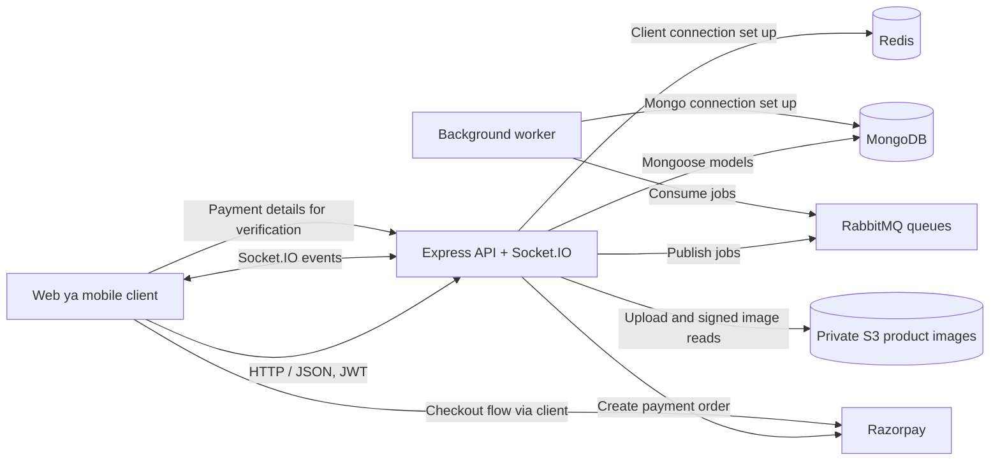

# ProCommerce Backend - High-Level Design (HLD)

Yeh document application ka overall structure samjhata hai: kaun se bade components
hain, woh ek doosre se kaise baat karte hain, aur ek request ka safar kaisa hota hai.
Yeh design current source code aur `docker-compose.yml` par based hai.

## 1. Application ka purpose

ProCommerce ek e-commerce backend hai. Iska API users, products, carts, orders,
payments aur admin operations handle karta hai. Kuch background work RabbitMQ
ke zariye worker process tak bheja jata hai. Socket.IO real-time events provide
karta hai.

## 2. System ka overall diagram



Redis client startup par connect hota hai, lekin current source mein cache
operations implement nahi hain. Worker jobs consume karta hai; filhaal email,
order aur payment handling simulated logging/delay hai, production integrations
nahi.

## 3. Main components

| Component | Kaam |
| --- | --- |
| Express API | `/api/v1` REST endpoints, request middleware, business logic ko call karna aur JSON response dena |
| JWT/RBAC middleware | Bearer token validate karna aur role ke hisaab se routes allow karna |
| MongoDB + Mongoose | Users, products, carts, orders, payments aur notifications ka persistent data |
| Redis | Connection initialize hota hai; is codebase mein cache/token store ka actual use nahi hai |
| RabbitMQ | `ORDER_QUEUE`, `EMAIL_QUEUE` aur `PAYMENT_QUEUE` par asynchronous jobs |
| Worker | Queues se jobs read karke abhi simulated processing karta hai |
| Razorpay | Payment order create karna aur payment signature verify karna |
| Private S3 | Product image objects ko private rakhna; API upload aur short-lived signed reads |
| Socket.IO | Order-related aur chat events ko connected clients tak bhejna |
| Swagger UI | API documentation, `/api-docs` par |

## 4. Request ka flow

1. Client API ko HTTP request bhejta hai. Protected request mein
   `Authorization: Bearer <JWT>` header hota hai.
2. Express security, CORS, logging aur JSON parsing middleware chalata hai.
3. Route request ko controller tak bhejta hai. Protected routes pehle JWT
   validate karte hain; kuch routes role bhi check karte hain.
4. Controller service/model ka use karke kaam karta hai.
5. Data MongoDB mein read/write hota hai. Order ya payment flow zarurat par
   RabbitMQ queue mein job publish karta hai.
6. API JSON response bhejta hai; selected flows Socket.IO event bhi emit karte hain.

## 5. Order aur payment ka high-level flow

```mermaid
sequenceDiagram
    participant C as Client
    participant A as Express API
    participant M as MongoDB
    participant Q as RabbitMQ
    participant W as Worker
    participant R as Razorpay

    C->>A: POST /api/v1/orders/create (JWT)
    A->>M: Pending order save
    A->>Q: ORDER_QUEUE + EMAIL_QUEUE jobs
    A-->>C: 201 order response
    Q->>W: Order/email job
    W-->>W: Simulated job processing
    C->>A: POST /api/v1/payments/create-intent
    A->>R: Razorpay order create
    R-->>A: Razorpay order
    A-->>C: Razorpay order details
    C->>R: Checkout/payment
    C->>A: POST /api/v1/payments/verify
    A->>A: HMAC signature verify
    A->>M: Payment save; order paid update
    A->>Q: PAYMENT_QUEUE job
    A-->>C: Payment verification response
```

Order create endpoint body se order data lekar order record banata hai. Payment
intent ke baad client Razorpay checkout se payment karta hai aur verification
details backend ko bhejta hai. Amount conversion INR rupees se paise mein Razorpay
order banate waqt hota hai.

## 6. Deployment view

Docker Compose mein paanch services hain:

| Service | Container role | Exposed port |
| --- | --- | --- |
| `api` | Express API aur Socket.IO | `5000` |
| `worker` | RabbitMQ consumer | Host port map nahi hai |
| `mongo` | MongoDB database; `mongo_data` named volume | `27017` |
| `redis` | Redis | `6379` |
| `rabbitmq` | Message broker aur management UI | `5672`, UI `15672` |

`api` aur `worker` dono same Docker image se bante hain; worker alag command
(`npm run worker`) chalata hai. Compose ka `depends_on` container start order
set karta hai, service readiness guarantee nahi. Isliye RabbitMQ fresh startup
par ready hone se pehle API/worker connect attempt kar sakte hain. API ke current
startup path mein RabbitMQ connection fail hone par warning aati hai, lekin
automatic retry nahi hota.

## 7. Configuration

Compose services root `.env` file load karti hain. Code mein istemal hone wale
variables ke naam:

- `PORT`
- `MONGO_URI`
- `REDIS_URL`
- `RABBITMQ_URL`
- `JWT_SECRET`, `JWT_EXPIRE`
- `RAZORPAY_KEY_ID`, `RAZORPAY_KEY_SECRET`, `RAZORPAY_WEBHOOK_SECRET`
- `NODE_ENV`
- `AWS_REGION`, `S3_BUCKET`, `S3_SIGNED_URL_TTL_SECONDS` (optional TTL, default 300 seconds)

Secret values ko source control ya documentation mein na rakhein. Real
credentials `.env` mein hi configure karein.

Product image uploads seller/admin-only `POST /api/v1/products/images` par
multipart `image` field se hote hain. JPEG, PNG, WebP aur 5 MB tak ki files
accepted hain. MongoDB mein stable API URL store hota hai; GET image route
short-lived S3 URL par redirect karta hai. Bucket par public access block
enabled rehna chahiye. Local use mein AWS SDK credential chain aur ECS mein task
role istemal karein.

## 8. Important current implementation boundaries

- `/health` sirf API process ka response deta hai. `/api/v1/health` JSON mein
  Mongo/queue labels deta hai, lekin har dependency ka live health check nahi karta.
- Redis startup par connect hota hai, par current feature flows Redis cache use nahi karte.
- Worker email bhejne ke bajaye job log karta hai; order/payment jobs bhi abhi
  simulated processing hain.
- Webhook handler signature validity log karta hai, par valid/invalid hone ke
  bawajood abhi `{"status":"ok"}` response deta hai aur payment state update nahi karta.
- Kuch routes mock responses dete hain; unhein production-complete feature na samjhein.
- Order room join aur chat events Socket.IO mein hain. Room join par order-level
  authorization check implemented nahi hai.
- Payment/order demo flow ke source mein production ke liye zaroori validation,
  authorization aur failure handling har jagah complete nahi hai.

## 9. Source code ke entry points

- `src/server.js` - API startup, middleware, health endpoints, Swagger aur Socket.IO
- `src/routes/` - HTTP route definitions
- `src/controllers/` - HTTP request/response handling
- `src/services/` - business operations
- `src/models/` - Mongoose schemas
- `src/config/` - MongoDB, Redis, RabbitMQ aur Razorpay clients
- `src/workers/consumer.js` - background queue consumer
- `src/sockets/socketHandler.js` - Socket.IO events

Detailed route aur data information ke liye [LLD.md](./LLD.md) dekhein.
